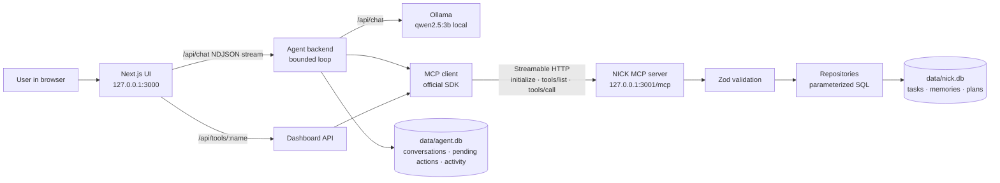

# NICK — Natural-language Intelligence for Contextual Knowledge

> It understands your goals. It remembers your context. It gets things done.

NICK is a local, zero-cost personal AI assistant with a JARVIS-inspired interface. It manages your tasks, study plans and user-controlled memory by calling **real MCP tools** on a **self-hosted MCP server** (Streamable HTTP, protocol `2025-11-25`), and answers everyday questions in between. The AI model runs on your own computer through [Ollama](https://ollama.com/). No paid API, cloud account or API key is needed.

Built for the **Amazon Developer Hackathon 2026 — Alexa+ track**, using the *self-hosted MCP server* route. NICK is **not** connected to an Alexa device; its web client simulates the Alexa+ assistant experience on top of the real MCP server.

---

## Contents

1. [Problem](#problem) · 2. [Solution](#solution) · 3. [Features](#key-features) · 4. [Architecture](#architecture) · 5. [Tech stack](#technology-stack)
6. [Prerequisites](#prerequisites) · 7. [Windows setup](#windows-setup) · 8. [Ollama and the local model](#ollama-and-the-local-model) · 9. [Configuration](#configuration)
10. [Database](#database) · 11. [Running NICK](#running-nick) · 12. [Tests](#tests) · 13. [Example MCP calls](#example-mcp-calls)
14. [Troubleshooting](#troubleshooting) · 15. [Security notes](#security-notes) · 16. [Known limitations](#known-limitations) · 17. [Hackathon context](#hackathon-context) · 18. [License](#license)

---

## Problem

Students and busy people keep goals, deadlines and preferences scattered across apps and their own heads. Chat assistants can talk about a plan, but they usually don't **do** anything verifiable. They forget your preferences between conversations, and some of them claim actions that never happened. Cloud assistants also send personal data off the device and often need paid API keys.

## Solution

NICK combines a local language model with a standards-compliant **MCP server** that owns your data:

- The model decides *what* to do; every change happens through a real MCP `tools/call` that is validated and stored in SQLite.
- Relevant saved memory, and only that, is retrieved for each request, so NICK can use your preferences across conversations.
- Destructive actions and saving study plans never run on the model's word alone; you confirm them in the UI.
- Every tool call is shown with its real status and duration. If the model *claims* an action that no tool performed, NICK catches it and corrects or replaces the reply.

## Key features

| Area | What works |
|---|---|
| **MCP server** | Official TypeScript SDK (`@modelcontextprotocol/sdk` 1.32.1); Streamable HTTP at `/mcp`; stateful sessions; protocol `2025-11-25`; 16 tools with Zod-validated inputs, structured results and annotations; Origin/Host checks; runs independently |
| **Tasks** | Create, list (status/priority/category/due range/search), get, update, complete, delete (with confirmation); accurate overdue flags |
| **Study planner** | Deterministic, transparent scheduler: never exceeds your hours per day, spreads sessions, weights harder subjects; preview → approve → save (optionally as tasks); mark sessions done |
| **Memory** | Save, search (SQLite FTS5 ranking), update, delete, clear all (typed confirmation); "saved by you" vs "inferred by NICK" labels; refuses passwords, keys and ID numbers |
| **Agent** | Bounded loop (max steps, max tool calls, timeouts), duplicate-call guard, malformed-argument handling, unknown-tool rejection, claim verification, JSON-mode fallback; **Stop** cancels a run (the model call is aborted, a tool call already started finishes, nothing new starts, and the reply lists what was actually done) |
| **UI** | Next.js chat with live tool activity, conversation history, task dashboard, planner, memory manager, settings/status page with the live MCP handshake; JARVIS-inspired dark HUD theme with an animated status core (idle / working / speaking / offline); mobile layout |
| **Voice** | Optional spoken replies (off by default) using the browser's built-in speech synthesis with an **on-device voice only**; cloud voices are never used. No voice input yet (see [Known limitations](#known-limitations)) |
| **Cost** | INR 0: everything is open source and local |

## Architecture



- **User data** (`data/nick.db`) is opened only by the MCP server. The web app never queries it directly; dashboard pages also go through MCP `tools/call`.
- **Agent state** (`data/agent.db`) holds conversations, pending confirmations and the activity log, kept separate from user data.
- There is no arbitrary SQL, shell or filesystem tool. The model sees only an allow-listed set of tools, with app-controlled fields (such as `confirm`) hidden from it.

```
nick/
├─ server/            MCP server (index.ts = entry, httpApp.ts = Streamable HTTP, mcpServer.ts = tools)
├─ lib/               config, SQLite + migrations, repositories, Zod schemas, study planner, MCP client
├─ src/agent/         Ollama adapter, agent loop, tool policy, agent store
├─ src/app/           Next.js pages and API routes
├─ src/components/    UI components
├─ scripts/           db-init, Ollama check, MCP smoke test, live and browser end-to-end checks
├─ tests/             Vitest suites (DB, planner, MCP protocol, agent, Ollama adapter, API routes)
└─ docs/              demo script, product feedback, friction log, submission draft
```

## Technology stack

Next.js 16 · React 19 · TypeScript 5.9 · Tailwind CSS 4 · Node.js 22 · `@modelcontextprotocol/sdk` 1.32.1 · Express 5 (via the SDK helper) · better-sqlite3 (SQLite 3.53 with FTS5) · Zod 4 · Ollama + `qwen2.5:3b` · Vitest 5 · playwright-core (drives the locally installed Microsoft Edge; no browser download)

## Prerequisites

| Requirement | Notes |
|---|---|
| Windows 10/11 | Developed and tested on Windows 11 with PowerShell 5.1 |
| Node.js **22.12 or newer** (22.x LTS) | Includes npm 10. Check with `node --version` |
| [Ollama](https://ollama.com/download) | Free. Runs the model locally |
| ~3 GB free disk | ~1.9 GB for the model, ~0.5 GB for `node_modules` |
| RAM | Tested on 8 GB RAM, CPU only. More RAM or a supported GPU makes replies faster |
| Git (optional) | Only needed to clone; you can also download the ZIP |

## Windows setup

Run these in **PowerShell**:

```powershell
git clone <your-repo-url> nick      # or download and extract the ZIP
cd nick
npm install
Copy-Item .env.example .env         # optional; defaults work without it
```

No Visual Studio or C++ build tools are needed. The repository's `.npmrc` sets `ignore-scripts=true` so npm uses `better-sqlite3`'s bundled prebuilt binary instead of trying to compile it (see Troubleshooting).

## Ollama and the local model

1. Install Ollama from <https://ollama.com/download> and start it (it runs in the system tray and listens on `127.0.0.1:11434`).
2. Download the default model (~1.9 GB, one time):

   ```powershell
   ollama pull qwen2.5:3b
   ```

3. Check that the model is installed and can make a tool call:

   ```powershell
   npm run check:ollama
   ```

   Expected last line: `Native tool calling: OK`.

**Why `qwen2.5:3b`?** It supports tool calling and fits in 8 GB of RAM on a CPU-only laptop. If you have more memory or a GPU, you can try a larger tool-capable model (for example `qwen2.5:7b`) by setting `OLLAMA_MODEL` in `.env`. This hasn't been tested in this project.

## Configuration

All settings are optional. Copy `.env.example` to `.env` to change them. **No secrets are required.**

| Variable | Default | Purpose |
|---|---|---|
| `NICK_MCP_HOST` | `127.0.0.1` | Interface the MCP server binds to (loopback only) |
| `NICK_MCP_PORT` | `3001` | MCP server port |
| `NICK_MCP_URL` | `http://127.0.0.1:3001/mcp` | Where the web app reaches the MCP server |
| `NICK_DATA_DIR` | `./data` | Folder for the SQLite databases |
| `OLLAMA_BASE_URL` | `http://127.0.0.1:11434` | Local Ollama API |
| `OLLAMA_MODEL` | `qwen2.5:3b` | Model name |
| `OLLAMA_TOOL_MODE` | `auto` | `native` tool calling, `json` structured-output adapter, or `auto` (native with JSON fallback) |
| `OLLAMA_TIMEOUT_MS` | `180000` | Timeout for one model call |
| `AGENT_MAX_ITERATIONS` | `6` | Max model steps per request |
| `AGENT_MAX_TOOL_CALLS` | `8` | Max tool calls per request |
| `MCP_TOOL_TIMEOUT_MS` | `15000` | Timeout for one MCP tool call |

## Database

The databases are created automatically on first start. To create or check them explicitly:

```powershell
npm run db:init
```

This is safe to run repeatedly: migrations are tracked with `PRAGMA user_version` and never drop data. To start from scratch, stop NICK and delete the `data` folder (this permanently deletes your tasks and memories).

## Running NICK

**Recommended (production build, lower memory use):**

```powershell
npm run build
npm start
```

**Development (hot reload):**

```powershell
npm run dev
```

Both commands start **two services in one terminal**: the MCP server (`[mcp]`, port 3001) and the web app (`[web]`, port 3000). Open **<http://127.0.0.1:3000>**. Stop both with **Ctrl+C**.

To run the MCP server on its own, for example for another MCP client:

```powershell
npm run start:mcp        # http://127.0.0.1:3001/mcp, health check at http://127.0.0.1:3001/health
```

**In the chat:** press **■ Stop** to cancel a request that is taking too long. Use the **🔈 Voice** button in the chat header to have replies read aloud (it is disabled when Windows has no on-device voice installed).

**First reply:** when the chat page opens, NICK warms up the model in the background. On a CPU-only laptop this takes about 2–4 minutes once. After that, replies took 12–30 s in our tests. The composer shows the warm-up status. The dashboards (Tasks, Study plans, Memory) work immediately and don't need the model.

## Tests

```powershell
npm test               # 80 automated tests (Vitest): DB, planner, MCP protocol, agent, Ollama adapter, API routes
npm run typecheck      # TypeScript, no emit
npm run smoke:mcp      # real initialize → tools/list → tools/call against a RUNNING MCP server
```

The automated tests use temporary databases and never touch `./data`. The model is replaced by a scripted fake in agent tests; MCP calls in those tests are real.

End-to-end checks against **running services and the real model**. They create records, so point NICK at a throwaway data folder first:

```powershell
$env:NICK_DATA_DIR = "$env:TEMP\nick-e2e"
npm run build; npm start            # terminal 1
npm run test:live                   # terminal 2: chat → Ollama → MCP → SQLite (10 checks)
npm run test:ui                     # browser test in headless Microsoft Edge (needs an EMPTY data folder)
```

**Recorded results (2026-10-23, Windows 11, Ryzen 5 7520U, 8 GB RAM, CPU only, Ollama 0.40.8, Node.js 22.23.4):**

- `npm test`: 80 / 80 passed
- `npm run test:live` (production build): 10 / 10 passed (task creation, retrieval, memory save, memory retrieval in a new conversation, delete confirmation and cancel, study plan preview and save). Replies took 13–23 s with a warm model.
- `npm run test:ui` (production build): 14 / 14 passed (empty states, create/edit/complete/delete with confirmation, persistence after reload, memory with typed clear-all confirmation, planner preview vs. save, live MCP status, a real chat run, conversation history, 390 px mobile layout, no script errors).
- Clean start from only the files Git would publish: `npm install` (no build tools), `npm run db:init`, `npm test` 80/80, `npm run build`, `npm run smoke:mcp`, `npm run check:ollama` and `npm run test:live` 10/10 all passed.
- Manual checks with the real model: pressing **Stop** in the browser ended the run 0.1 s later with "Stopped at your request. No actions were completed." and no task was created; a chat-initiated deletion was executed only after Confirm, and confirming the same action twice was refused.
- An earlier UI run failed its chat check because Ollama's auto-updater stopped the Ollama server mid-run; NICK reported "Ollama is not reachable" as intended (see `docs/FRICTION_LOG.md`).

## Example MCP calls

Any MCP client that supports Streamable HTTP can connect to `http://127.0.0.1:3001/mcp`. Raw example in **PowerShell** (responses arrive as server-sent events):

```powershell
$mcp = 'http://127.0.0.1:3001/mcp'
$headers = @{ Accept = 'application/json, text/event-stream' }

# 1. initialize (capability negotiation); the server returns an Mcp-Session-Id header
$init = Invoke-WebRequest -Uri $mcp -Method Post -Headers $headers -ContentType 'application/json' -UseBasicParsing `
  -Body '{"jsonrpc":"2.0","id":1,"method":"initialize","params":{"protocolVersion":"2025-11-25","capabilities":{},"clientInfo":{"name":"powershell","version":"1.0"}}}'
$headers['Mcp-Session-Id'] = $init.Headers['Mcp-Session-Id']
$headers['MCP-Protocol-Version'] = '2025-11-25'

# 2. initialized notification (HTTP 202)
Invoke-WebRequest -Uri $mcp -Method Post -Headers $headers -ContentType 'application/json' -UseBasicParsing `
  -Body '{"jsonrpc":"2.0","method":"notifications/initialized"}' | Out-Null

# 3. tools/list
(Invoke-WebRequest -Uri $mcp -Method Post -Headers $headers -ContentType 'application/json' -UseBasicParsing `
  -Body '{"jsonrpc":"2.0","id":2,"method":"tools/list"}').Content

# 4. tools/call
(Invoke-WebRequest -Uri $mcp -Method Post -Headers $headers -ContentType 'application/json' -UseBasicParsing `
  -Body '{"jsonrpc":"2.0","id":3,"method":"tools/call","params":{"name":"create_task","arguments":{"title":"Revise chapter 4","priority":"high","dueDate":"2026-10-30"}}}').Content

# 5. end the session
Invoke-WebRequest -Uri $mcp -Method Delete -Headers $headers -UseBasicParsing | Out-Null
```

Example `tools/call` result (abridged):

```json
{"result":{"content":[{"type":"text","text":"Created task #32 \"Revise chapter 4\". ..."}],
 "structuredContent":{"success":true,"summary":"Created task #32 \"Revise chapter 4\".","taskId":32,
 "task":{"id":32,"title":"Revise chapter 4","status":"pending","priority":"high","dueDate":"2026-10-30","overdue":false}}},
 "jsonrpc":"2.0","id":3}
```

**Tools:** `create_task`, `list_tasks`, `get_task`, `update_task`, `complete_task`, `delete_task`*, `create_study_plan`, `get_study_plan`, `list_study_plans`, `update_study_plan_item`, `delete_study_plan`*, `save_memory`, `search_memory`, `update_memory`, `delete_memory`*, `clear_memories`*. Tools marked * are destructive: they require `"confirm": true`, which a client must only send after a human confirmed. In NICK's own agent the model can never set it.

## Troubleshooting

| Symptom | Fix |
|---|---|
| Banner: "MCP server not reachable" | Start NICK with `npm start` / `npm run dev`; check that port 3001 is free: `Get-NetTCPConnection -LocalPort 3001 -State Listen` |
| `Port 3001 is already in use` | Stop the other process, or set `NICK_MCP_PORT` **and** `NICK_MCP_URL` in `.env` |
| Banner: "Ollama is not running" | Start the Ollama app (tray icon) or run `ollama serve`; then `npm run check:ollama` |
| "Model … is not installed" | `ollama pull qwen2.5:3b` (or the model in `OLLAMA_MODEL`) |
| First reply very slow or "did not answer within 180s" | Wait for the warm-up to finish (shown under the message box); close memory-heavy apps; on slow machines set `OLLAMA_TIMEOUT_MS=300000` in `.env` |
| Chat stops working mid-session | Ollama may be auto-updating (the tray app restarts the server). Wait for it to finish, then retry |
| `npm install` fails with `Cannot read properties of null (reading 'edgesOut')` | An npm 10 bug triggered by some peer-dependency chains. Delete `node_modules` and `package-lock.json` and run `npm install` again with the versions in `package.json` |
| `npm install` fails with `gyp ERR! find VS … Could not find any Visual Studio installation` | npm tried to compile `better-sqlite3` from source. Make sure the repository's `.npmrc` (with `ignore-scripts=true`) is present, or run `npm install --ignore-scripts`; the package ships prebuilt binaries |
| Page shows old data after editing `.env` | Restart NICK; configuration is read at startup |

## Security notes

NICK is a **single-user local application**, built with reasonable safeguards for a prototype. It has **not** had a professional security review.

- Both services bind to `127.0.0.1` only. The MCP server rejects foreign `Host` headers (SDK DNS-rebinding protection) and foreign `Origin` headers.
- Every MCP tool argument is validated with Zod (strict objects, enums, length limits, real calendar dates). Every web API request body is validated too.
- All SQL is parameterized; there is no SQL, shell or filesystem tool. User text such as `x'); DROP TABLE tasks; --` is stored as plain data (tested).
- Destructive operations need explicit confirmation. Pending actions store their arguments server-side, so a confirmation request cannot change what gets deleted, and each pending action can run only once.
- Request size limits: 100 KB per MCP request, 64 KB per web API request, 4,000 characters per chat message.
- Web API writes must be JSON from the same origin (cross-site requests are rejected).
- Errors shown to users never include stack traces; database errors are replaced by a generic message.
- Memory refuses content that looks like passwords, API keys, card or ID numbers. Tool logs store tool name, status and duration, never arguments.
- Spoken replies use only voices that the browser reports as on-device (`localService`), so reply text is never sent to a cloud speech service.
- The databases live in `./data`, outside the web-served folders, and are ignored by Git.

**Limitations:** there is no login and no multi-user isolation. Anyone who can use this computer's browser can read and change the data. Prompt injection inside your own notes could influence the model's *choices*, but cannot bypass validation, the tool allow-list or confirmation. Don't expose ports 3000/3001 to a network without adding authentication.

## Known limitations

- **Speed on CPU:** with an 8 GB CPU-only laptop, the one-time warm-up takes about 2–4 minutes and replies take about 14–40 s. Ollama dropped the integrated AMD GPU by default on the test machine.
- **Small-model mistakes:** `qwen2.5:3b` sometimes paraphrases task titles, misreads numbers or returns an empty reply. NICK mitigates this with validation, previews, confirmations, a JSON fallback and claim checks. Always review proposed plans. General-knowledge answers come from the small model alone and can be wrong; NICK has no web access, so it cannot answer about news, weather or prices.
- **Voice:** spoken replies only. Voice *input* is not included: the browser speech-recognition API in Edge and Chrome sends audio to Microsoft's or Google's servers, which would break NICK's local-only promise. A local speech-to-text engine is future work. Spoken replies need an on-device Windows voice (Settings → Time & language → Speech).
- **Stop:** cancelling does not undo a tool call that had already started; the reply lists everything that completed.
- **Study planner:** a simple, deterministic rule (difficulty weights, even spacing, daily cap). It is a starting point, not an optimal plan.
- **Single user, no authentication**, local only.
- **No real Alexa device integration**; the web client simulates the conversational experience on top of the real MCP server.
- Conversation transcripts are capped at the 200 most recent messages per conversation.
- Dates use the computer's local timezone; tasks have dates but no times.

## Hackathon context

- **Event:** Amazon Developer Hackathon 2026 — Alexa+ track.
- **Route:** self-hosted MCP server, implemented with the official TypeScript MCP SDK over Streamable HTTP (protocol `2025-11-25`), demonstrated through a web client. The official rules (checked 2026-10-23) require "a working Agent Skill or a self-hosted MCP server, implementing MCP spec version 2025-11-25 … over Streamable HTTP" and allow developers to "simulate the Alexa+ experience in a web app". NICK enters through the MCP-server path; the web client is the optional simulation, and it talks to the MCP server through the official SDK client (`initialize`, `tools/list`, `tools/call`), not a mock.
- **What is real:** MCP initialization, capability negotiation, `tools/list` and `tools/call` over HTTP; SQLite persistence; local AI inference via Ollama.
- **What is not claimed:** no Alexa+ device or partner-only tooling is used.
- Submission materials: [`docs/SUBMISSION.md`](docs/SUBMISSION.md), [`docs/DEMO_SCRIPT.md`](docs/DEMO_SCRIPT.md), [`docs/PRODUCT_FEEDBACK.md`](docs/PRODUCT_FEEDBACK.md), [`docs/FRICTION_LOG.md`](docs/FRICTION_LOG.md).

## License

NICK's source code is released under the [MIT License](LICENSE).

Dependencies are installed by `npm install` and are not committed; they keep their own licenses. A scan of the installed packages (2026-10-23) found 194 of 206 under MIT, ISC or Apache-2.0. The rest: BSD-2/BSD-3/0BSD (5), MPL-2.0 (`lightningcss`, a Tailwind build tool), CC-BY-4.0 (`caniuse-lite` browser data), and Apache-2.0/LGPL-3.0 (`@img/sharp-*`, image-processing binaries that Next.js installs and NICK does not use). The **model is not part of this repository**: `qwen2.5:3b` is downloaded separately through Ollama and is distributed by its authors under the *Qwen Research License*. Review that license before any commercial use, or configure a model whose license suits your use.
